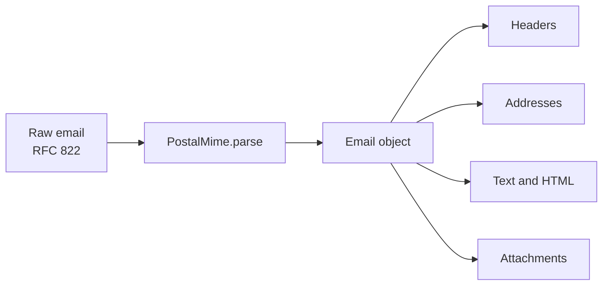

# postal-mime


**postal-mime** is an email parsing library for Node.js, browsers (including Web Workers) and serverless runtimes such as Cloudflare Email Workers. It takes a raw email message in RFC 822 format and returns a structured object with its headers, addresses, text and HTML bodies, and attachments.

```javascript
import PostalMime from 'postal-mime';

const email = await PostalMime.parse(`Subject: Hello World
Content-Type: text/html; charset=utf-8

<p>Welcome to postal-mime!</p>`);

console.log(email.subject); // "Hello World"
console.log(email.html);    // "<p>Welcome to postal-mime!</p>\n"
```

## Features

- **No runtime dependencies.**
- **Runs anywhere with `TextDecoder`, `Blob` and `ReadableStream`:** Node.js 20 or newer, browsers, Web Workers, Deno, Bun and Cloudflare Workers.
- **ES module and CommonJS builds**, compiled from the same TypeScript source, each with its own type declarations.
- **MIME handling:** multipart messages, nested `message/rfc822` parts, RFC 2047 encoded words, RFC 2231 parameters, `format=flowed` text, and the charset labels mail clients use in practice.
- **Security limits** on nesting depth, header size, part count, nested message recursion and forwarded addresses, so a crafted message cannot exhaust memory or CPU.

## Installation

```bash
npm install postal-mime
```

## How it works



The whole message is read into memory and parsed in one pass into a tree of MIME parts. Text and HTML parts become the `text` and `html` bodies, every other part becomes an attachment, and inline forwarded messages are parsed recursively.

## Where to go next

- [Installation](./getting-started/installation) - Requirements and import paths for every runtime
- [Quick Start](./getting-started/quick-start) - Parse a first message
- [Parser Options](./api/options) - Every option and its default
- [Email Object](./api/email) - Every property of the result
- [Security](./guides/security) - Parsing untrusted mail
- [Live Demo](/demo) - Parse a message in the browser

## Related projects

postal-mime is developed by the makers of [EmailEngine](https://emailengine.app/), a self-hosted email gateway that provides a REST API for IMAP and SMTP servers and sends webhooks whenever something changes in registered accounts.

## See Also

- [GitHub repository](https://github.com/postalsys/postal-mime) - Source, issues and the CHANGELOG
- [npm package](https://www.npmjs.com/package/postal-mime) - Published releases
- [AI Agent Reference](./llm-context) - The whole API on one page
- [Troubleshooting](./troubleshooting) - Common problems and fixes
